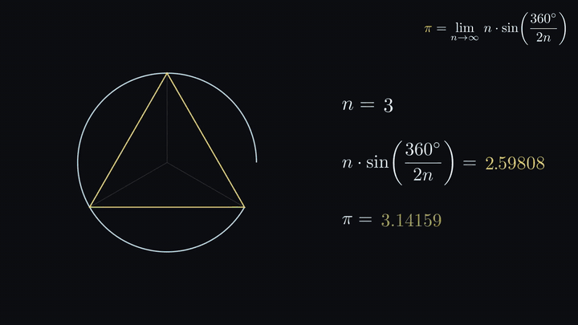

# manim-pi

An animated walkthrough of a neat way to calculate pi:

$$\pi = \lim_{n \to \infty} n \cdot \sin\left(\frac{360^\circ}{2n}\right)$$



Full video (1080p60, about a minute): [assets/pi_limit.mp4](assets/pi_limit.mp4)

## Background

I came across this formula in *Struck by Genius* by Jason Padgett and Maureen Seaberg. Padgett had no interest in math until a brain injury left him seeing the world as geometric shapes. One of the ideas he describes is that a circle is really a polygon with an infinite number of sides, and that you can get pi out of that picture with nothing more than a sine function.

I wanted to see it move, so I built this animation with [Manim](https://www.manim.community/).

## How the formula works

1. Start with a circle of radius 1, so the diameter is 2.
2. Cut it into `n` equal slices. Each slice has a central angle of `360° / n`.
3. Draw a polygon by connecting the points where the slices meet the circle.
4. Bisect one slice. You get two right triangles, each with an angle of `360° / 2n` at the center and a hypotenuse of 1.
5. The side opposite that angle is `sin(360° / 2n)`, so one full side of the polygon is `2 · sin(360° / 2n)`.
6. The perimeter of the polygon is `n · 2 · sin(360° / 2n)`.
7. Divide by the diameter (2) and you get `n · sin(360° / 2n)`.
8. As `n` grows, the polygon hugs the circle more and more tightly. Perimeter over diameter becomes circumference over diameter, which is pi.

Some values along the way:

| n | n · sin(360° / 2n) |
|---:|---|
| 3 | 2.59808 |
| 6 | 3.00000 |
| 12 | 3.10583 |
| 96 | 3.14103 |
| 1,000 | 3.14159 |

Archimedes used the same 96-sided polygon to show that pi is a little more than 3 10/71.

## Scenes

The animation is a single Manim scene (`PiLimit`) split into five parts:

- **intro**: the formula by itself
- **slices**: a circle cut into 6 slices, then one slice is bisected to find the side length
- **derivation**: perimeter over diameter, step by step
- **converge**: the polygon grows from 3 to 96 sides while the value approaches pi
- **outro**: the boxed formula

## Rendering it yourself

Manim needs a few system packages (FFmpeg, a LaTeX distribution, Cairo and Pango). See the [Manim install guide](https://docs.manim.community/en/stable/installation.html) for your OS.

```bash
python -m venv .venv
source .venv/bin/activate
pip install -r requirements.txt

# 1080p60
manim -qh pi_limit.py PiLimit

# quick low-res preview
manim -pql pi_limit.py PiLimit
```

The output goes to `media/videos/pi_limit/<quality>/PiLimit.mp4`.

## License

MIT
